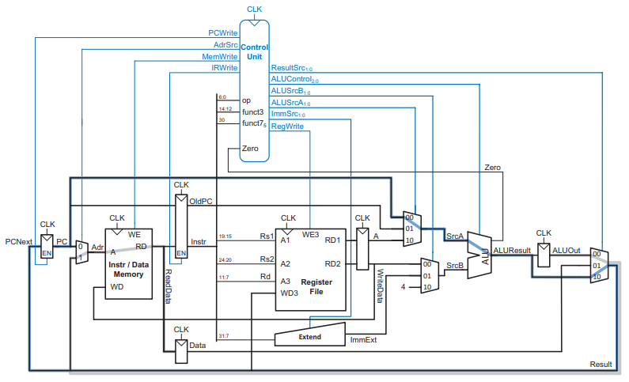
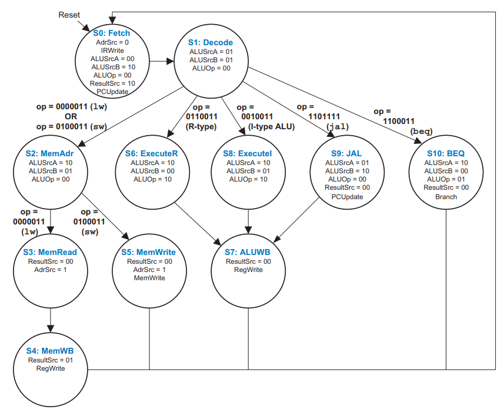
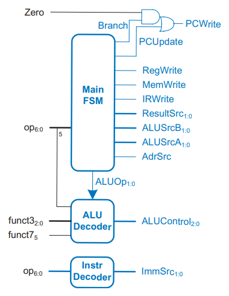

# RISC-V Multicycle Processor

This project implements the Multicycle Processor from [_Digital Design and Computer Architecture: RISC-V Edition_](../static/digital-design-computer-architecture-riscv.pdf) from chapter 7.4.

<p align="center">
    
</p>

## Usage

### Dependencies

This project uses [`just`](https://github.com/casey/just) for command running, [`ghdl`](https://gihub.com/ghdl) for VHDL compilation and [`gtkwave`](https://github.com/gtkwave/gtkwave) for visualization. To install them on Debian-based distros:

```shell
~$ apt install just ghdl gtkwave
```

### Running

To list available recipes:
```shell
~$ just
Available recipes:
    clean                      # Delete artifacts from work directory
    test component="component" # Test individual components: cpu, adder, alu, control, dmem, imem, immext, mux, pc, regfile
    test-all                   # Test all components
    wave component="component" # Test and view waveforms for components: cpu, adder, alu, control, dmem, imem, immext, mux, pc, regfile (press CTRL+0 to adjust the zoom)
```

`just test cpu` will run the CPU against the the assembly code below, which loads the value on the address pointed to by the Global Pointer (gp) onto `x5` and then doubles it in a infinite loop:

```asm
.data
.word 1

.text
    lw t0,0(gp)
LOOP:  add t0,t0,t0
    j LOOP
```

```shell
src/cpu.vhd:542:13:@30ns:(report note): [1] PC: 0x00000004
src/cpu.vhd:543:13:@30ns:(report note): [1] Instr: 0x0001A283 (lw x5, 0(x3))
src/cpu.vhd:546:13:@30ns:(report note): [1] FSM: S1_DECODE
src/cpu.vhd:547:13:@30ns:(report note): [1] CU: PCWrite='0' IRWrite='0' RegWrite='0' MemWrite='0'
src/cpu.vhd:548:13:@30ns:(report note): [1]     AdrSrc='0' ResultSrc=00 ALUSrcA=01 ALUSrcB=01
src/cpu.vhd:556:13:@30ns:(report note): [1] ALU: 0x00000000 + 0x00000000 = 0x00000000 (Zero='1')
src/cpu.vhd:559:13:@30ns:(report note): [1] Memory Address: 0x00000004 (AdrSrc='0')
src/cpu.vhd:561:13:@30ns:(report note):
src/cpu.vhd:542:13:@40ns:(report note): [2] PC: 0x00000004
src/cpu.vhd:543:13:@40ns:(report note): [2] Instr: 0x0001A283 (lw x5, 0(x3))
src/cpu.vhd:546:13:@40ns:(report note): [2] FSM: S2_MEMADR
src/cpu.vhd:547:13:@40ns:(report note): [2] CU: PCWrite='0' IRWrite='0' RegWrite='0' MemWrite='0'
src/cpu.vhd:548:13:@40ns:(report note): [2]     AdrSrc='0' ResultSrc=00 ALUSrcA=10 ALUSrcB=01
src/cpu.vhd:556:13:@40ns:(report note): [2] ALU: 0x10010000 + 0x00000000 = 0x10010000 (Zero='0')
src/cpu.vhd:559:13:@40ns:(report note): [2] Memory Address: 0x00000004 (AdrSrc='0')
src/cpu.vhd:561:13:@40ns:(report note):
src/cpu.vhd:542:13:@50ns:(report note): [3] PC: 0x00000004
src/cpu.vhd:543:13:@50ns:(report note): [3] Instr: 0x0001A283 (lw x5, 0(x3))
src/cpu.vhd:546:13:@50ns:(report note): [3] FSM: S3_MEMREAD
src/cpu.vhd:547:13:@50ns:(report note): [3] CU: PCWrite='0' IRWrite='0' RegWrite='0' MemWrite='0'
src/cpu.vhd:548:13:@50ns:(report note): [3]     AdrSrc='1' ResultSrc=00 ALUSrcA=00 ALUSrcB=00
src/cpu.vhd:556:13:@50ns:(report note): [3] ALU: 0x00000004 + 0x00000000 = 0x00000004 (Zero='0')
src/cpu.vhd:559:13:@50ns:(report note): [3] Memory Address: 0x10010000 (AdrSrc='1')
src/cpu.vhd:561:13:@50ns:(report note):
src/cpu.vhd:542:13:@60ns:(report note): [4] PC: 0x00000004
src/cpu.vhd:543:13:@60ns:(report note): [4] Instr: 0x0001A283 (lw x5, 0(x3))
src/cpu.vhd:546:13:@60ns:(report note): [4] FSM: S4_MEMWB
src/cpu.vhd:547:13:@60ns:(report note): [4] CU: PCWrite='0' IRWrite='0' RegWrite='1' MemWrite='0'
src/cpu.vhd:548:13:@60ns:(report note): [4]     AdrSrc='0' ResultSrc=01 ALUSrcA=00 ALUSrcB=00
src/cpu.vhd:552:17:@60ns:(report note): [4] Write to x5: 0x00000001
src/cpu.vhd:556:13:@60ns:(report note): [4] ALU: 0x00000004 + 0x00000000 = 0x00000004 (Zero='0')
src/cpu.vhd:559:13:@60ns:(report note): [4] Memory Address: 0x00000004 (AdrSrc='0')
src/cpu.vhd:561:13:@60ns:(report note):
src/cpu.vhd:542:13:@70ns:(report note): [5] PC: 0x00000004
src/cpu.vhd:543:13:@70ns:(report note): [5] Instr: 0x0001A283 (lw x5, 0(x3))
src/cpu.vhd:546:13:@70ns:(report note): [5] FSM: S0_FETCH
src/cpu.vhd:547:13:@70ns:(report note): [5] CU: PCWrite='1' IRWrite='1' RegWrite='0' MemWrite='0'
src/cpu.vhd:548:13:@70ns:(report note): [5]     AdrSrc='0' ResultSrc=10 ALUSrcA=00 ALUSrcB=10
src/cpu.vhd:556:13:@70ns:(report note): [5] ALU: 0x00000004 + 0x00000004 = 0x00000008 (Zero='0')
src/cpu.vhd:559:13:@70ns:(report note): [5] Memory Address: 0x00000004 (AdrSrc='0')
src/cpu.vhd:561:13:@70ns:(report note):
src/cpu.vhd:542:13:@80ns:(report note): [6] PC: 0x00000008
src/cpu.vhd:543:13:@80ns:(report note): [6] Instr: 0x005282B3 (add x5, x5, x5)
src/cpu.vhd:546:13:@80ns:(report note): [6] FSM: S1_DECODE
src/cpu.vhd:547:13:@80ns:(report note): [6] CU: PCWrite='0' IRWrite='0' RegWrite='0' MemWrite='0'
src/cpu.vhd:548:13:@80ns:(report note): [6]     AdrSrc='0' ResultSrc=00 ALUSrcA=01 ALUSrcB=01
src/cpu.vhd:556:13:@80ns:(report note): [6] ALU: 0x00000004 + 0x00000005 = 0x00000009 (Zero='0')
src/cpu.vhd:559:13:@80ns:(report note): [6] Memory Address: 0x00000008 (AdrSrc='0')
src/cpu.vhd:561:13:@80ns:(report note):
src/cpu.vhd:542:13:@90ns:(report note): [7] PC: 0x00000008
src/cpu.vhd:543:13:@90ns:(report note): [7] Instr: 0x005282B3 (add x5, x5, x5)
src/cpu.vhd:546:13:@90ns:(report note): [7] FSM: S6_EXECUTER
src/cpu.vhd:547:13:@90ns:(report note): [7] CU: PCWrite='0' IRWrite='0' RegWrite='0' MemWrite='0'
src/cpu.vhd:548:13:@90ns:(report note): [7]     AdrSrc='0' ResultSrc=00 ALUSrcA=10 ALUSrcB=00
src/cpu.vhd:556:13:@90ns:(report note): [7] ALU: 0x00000001 + 0x00000001 = 0x00000002 (Zero='0')
src/cpu.vhd:559:13:@90ns:(report note): [7] Memory Address: 0x00000008 (AdrSrc='0')
src/cpu.vhd:561:13:@90ns:(report note):
src/cpu.vhd:542:13:@100ns:(report note): [8] PC: 0x00000008
src/cpu.vhd:543:13:@100ns:(report note): [8] Instr: 0x005282B3 (add x5, x5, x5)
src/cpu.vhd:546:13:@100ns:(report note): [8] FSM: S7_ALUWB
src/cpu.vhd:547:13:@100ns:(report note): [8] CU: PCWrite='0' IRWrite='0' RegWrite='1' MemWrite='0'
src/cpu.vhd:548:13:@100ns:(report note): [8]     AdrSrc='0' ResultSrc=00 ALUSrcA=00 ALUSrcB=00
src/cpu.vhd:552:17:@100ns:(report note): [8] Write to x5: 0x00000002
src/cpu.vhd:556:13:@100ns:(report note): [8] ALU: 0x00000008 + 0x00000001 = 0x00000009 (Zero='0')
src/cpu.vhd:559:13:@100ns:(report note): [8] Memory Address: 0x00000008 (AdrSrc='0')
```

## Architectural State

The Unicycle processor has some shortcomings: separate `data` and `text` memories; has a cycle period bounded by the slowest instruction; and requires three adders, which are slow and expensive. The Multicycle processor fixes this by executing an instruction in many discrete steps, effectively speeding all but the slowest instruction (usually `lw`).

We join `data` and `text` memories into a single unified memory, since data and instruction are now read/written to on different cycles, and implement a single multi-purpose adder. To accomplish this, we must introduce _non-architectural state_ elements to hold information about an instruction through it's lifetime.

The controller is not combinatorial anymore, it now becomes a _Finite State Machine (FSM)_, as it needs to conciliate state and create signals for the specific step of an instruction's execution lifetime.

The instruction is now stored in a Instruction Register (IR). Data from the Register File is stored at another non-architectural element, the _A_ register.

## FSM States

These are the states that can be transitioned to during an instruction's lifetime. All instructions take 1 and 2, the others can be taken or not depending on the instruction:

01. [**Fetch**](#fetch-s0)
02. [**Decode**](#decode-s1)
03. [**MemAdr**](#memadr-s2)
04. [**MemRead**](#memread-s3)
05. [**MemWB**](#memwb-s4)
06. [**MemWrite**](#memwrite-s5)
07. [**ExecuteR**](#executer-s6)
08. [**ALUWB**](#aluwb-s7)
09. [**ExecuteI**](#executei-s8)
10. [**JAL**](#jal-s9)
11. [**BEQ**](#beq-s10)

This is the _FSM_ implemented inside the Control Unit:

<p align="center">
    
</p>

These are the datapaths for each micro operation (μOp):

| **State** | **Datapath μOp**                             |
| --------- | -------------------------------------------- |
| Fetch     | Instruction = Memory[PC] / PC = PC + 4       |
| Decode    | ALUOut = PCTarget                            |
| MemAdr    | ALUOut = rs1 + Imm                           |
| MemRead   | Data = Memory[ALUOut]                        |
| MemWB     | rd = Data                                    |
| MemWrite  | Memory[ALUOut] = rd                          |
| ExecuteR  | ALUOut = rs1                                 |  | op |  | rs2 |
| ExecuteI  | ALUOut = rs1                                 |  | op |  | Imm |
| ALUWB     | rd = ALUOut                                  |
| BEQ       | ALUResult = rs1 - rs2 (if Zero: PC = ALUOut) |
| JAL       | PC = ALUOut / ALUOut = PC + 4                |


### Fetch (S0)

Fetch the instruction from Memory at the address held at the PC register and write the current PC value to the _OldPC_ register.

`AdrSrc = 0` means that the address source is the PC register. `IRWrite = 1` means that the instruction can be written to the Instruction Register (IR).

```
Relevant Signals:

AdrSrc = 0
IRWrite = 1
ALUSrcA = 00
ALUSrcB = 10
ALUOp = 00
ResultSrc = 10
PCUpdate = 1
```

### Decode (S1)

Decodes the instruction fetched on the above step based on `op`, `funct3` and `funct7`. It also reads from `rs1` and `rs2` and writes them to the _A_ and _WriteData_ non-architectural registers.

```
Relevant Signals:

AluSrcA = 01
AluSrcB = 01
AluOp = 00
```

### MemAdr (S2)

Calculates the memory address by adding the base address to the offset using the _ALU_. The result (ALUResult) is then stored at the _ALUOut_ register.

```
Relevant Signals:

ALUSrcA = 10
ALUSrcB = 01
ALUOp = 00
```

### MemRead (S3)

Sends the value in _ALUOut_ to the address port of the unified Memory. The value at the address is then stored to the _Data_ register.

```
Relevant Signals:

ResultSrc = 00
AdrSrc = 1
```

### MemWB (S4)

Writes the data read from _Memory_ (written to the _Data Register_ at the MemRead step) to the destination register.

```
Relevant Signals:

ResultSrc = 01
RegWrite = 1
```

### MemWrite (S5)

```
Relevant Signals:

ResultSrc = 00
AdrSrc = 1
MemWrite = 1
```

### ExecuteR (S6)

Performs R-type ALU-related operations.

```
Relevant Signals:

ALUSrcA = 10
ALUSrcB = 00
ALUOp = 10
```

### ALUWB (S7)

Writes the result from the _ALU_ to the register file.

```
Relevant Signals:

ResultSrc = 00
RegWrite = 1
```

### ExecuteI (S8)

Performs I-type ALU-related operations.

```
Relevant Signals:

ALUSrcA = 10
ALUSrcB = 01
ALUOp = 10
```

### JAL (S9)

Updates the PC with the jump target address and writes the return address to the destination register.

```
Relevant Signals:

ALUSrcA = 01
ALUSrcB = 10
ALUOp = 00
ResultSrc = 00
PCUpdate = 1
```

### BEQ (S10)

Compares two registers to compute the target branch address.

```
Relevant Signals:

ALUSrcA = 10
ALUSrcB = 00
ALUOp = 01
ResultSrc = 00
Branch = 1
```

## Components

### Adder

Simple generic width adder without overflow and underflow detection.

```vhdl
ENTITY adder IS
    GENERIC (
        WIDTH : INTEGER := 32
    );
    PORT (
        a : IN STD_LOGIC_VECTOR(WIDTH - 1 DOWNTO 0);
        b : IN STD_LOGIC_VECTOR(WIDTH - 1 DOWNTO 0);
        result : OUT STD_LOGIC_VECTOR(WIDTH - 1 DOWNTO 0)
    );
END ENTITY adder;
```

### Arithmetic Logic Unit (ALU)

The ALU is responsible for executing arithmetic operations over two inputs and a control signal that determines which operation it must perform. Outputs the result and a zero flag useful for branching operations (beq, bne, blt, bge).

```vhdl
ENTITY alu IS
    PORT (
        src_a      : IN STD_LOGIC_VECTOR(31 DOWNTO 0);   -- First Operand
        src_b      : IN STD_LOGIC_VECTOR(31 DOWNTO 0);   -- Second Operand
        alu_control: IN STD_LOGIC_VECTOR(2 DOWNTO 0);    -- Operator
        alu_result : OUT STD_LOGIC_VECTOR(31 DOWNTO 0);  -- Operation Result
        zero       : OUT STD_LOGIC                       -- Zero flag, used for branching
    );
END ENTITY alu;
```

### Control Unit
The Control Unit for the Multicycle architecture is composed of an Instruction Decoder, an ALU decoder and a Finite-State Machine.

To implement the FSM, we simply need a register to hold the current state; the state itself is represented by an enum with all possible states. States are transitioned based on the current state and CPU signals.

<p align="center">
    
</p>

```vhdl
LIBRARY IEEE;
USE IEEE.STD_LOGIC_1164.ALL;
USE IEEE.NUMERIC_STD.ALL;

ENTITY control_unit IS
    PORT (
        clk : IN STD_LOGIC;
        opcode : IN STD_LOGIC_VECTOR(6 DOWNTO 0);
        funct3 : IN STD_LOGIC_VECTOR(2 DOWNTO 0);
        funct7 : IN STD_LOGIC_VECTOR(6 DOWNTO 0);
        zero : IN STD_LOGIC;
        pc_write : OUT STD_LOGIC;
        adr_src : OUT STD_LOGIC;
        mem_write : OUT STD_LOGIC;
        ir_write : OUT STD_LOGIC;
        result_src : OUT STD_LOGIC_VECTOR(1 DOWNTO 0);
        alu_control : OUT STD_LOGIC_VECTOR(2 DOWNTO 0);
        alu_src_a : OUT STD_LOGIC_VECTOR(1 DOWNTO 0);
        alu_src_b : OUT STD_LOGIC_VECTOR(1 DOWNTO 0);
        imm_src : OUT STD_LOGIC_VECTOR(1 DOWNTO 0);
        reg_write : OUT STD_LOGIC
    );
END ENTITY control_unit;
```

### Immediate Extender

Extends the immediate to the full 32 bits using sign extension (left pad with the sign bit until 32 bits). The values of `ImmSrc` we're chosen arbitrarly and are generated by the [Control Unit](#control-unit).

```vhdl
ENTITY immediate_extender IS
    PORT (
        instr : IN STD_LOGIC_VECTOR(31 DOWNTO 0);
        imm_src : IN STD_LOGIC_VECTOR(1 DOWNTO 0);
        imm_ext : OUT STD_LOGIC_VECTOR(31 DOWNTO 0)
    );
END ENTITY immediate_extender;
```

### Memory

The Multicycle architecture uses a unified memory for both `data` and `text` segments, since access to these regions ia made on different cycles. This is cheaper and less complex than the Unicycle approach with separate memories for each segment.

```vhdl
ENTITY memory IS
    GENERIC (
        ADDR_WIDTH : INTEGER := 12;
        DATA_WIDTH : INTEGER := 32;
        TEXT_MIF_FILE : STRING := "static/mif/text.mif";
        DATA_MIF_FILE : STRING := "static/mif/data.mif"
    );
    PORT (
        clk : IN STD_LOGIC;
        addr : IN STD_LOGIC_VECTOR(31 DOWNTO 0);
        wr_data : IN STD_LOGIC_VECTOR(31 DOWNTO 0);
        wr_en : IN STD_LOGIC;
        rd_data : OUT STD_LOGIC_VECTOR(31 DOWNTO 0)
    );
END ENTITY memory;
```

### Multiplexers

Basic 2-input and 4-input multiplexers, used for signal selection.

```vhdl
ENTITY mux2 IS
    GENERIC (
        WIDTH : INTEGER := 32
    );
    PORT (
        d0 : IN STD_LOGIC_VECTOR(WIDTH - 1 DOWNTO 0);
        d1 : IN STD_LOGIC_VECTOR(WIDTH - 1 DOWNTO 0);
        sel : IN STD_LOGIC;
        y : OUT STD_LOGIC_VECTOR(WIDTH - 1 DOWNTO 0)
    );
END ENTITY mux2;

ENTITY mux4 IS
    GENERIC (
        WIDTH : INTEGER := 32
    );
    PORT (
        d0 : IN STD_LOGIC_VECTOR(WIDTH - 1 DOWNTO 0);
        d1 : IN STD_LOGIC_VECTOR(WIDTH - 1 DOWNTO 0);
        d2 : IN STD_LOGIC_VECTOR(WIDTH - 1 DOWNTO 0);
        d3 : IN STD_LOGIC_VECTOR(WIDTH - 1 DOWNTO 0);
        sel : IN STD_LOGIC_VECTOR(1 DOWNTO 0);
        y : OUT STD_LOGIC_VECTOR(WIDTH - 1 DOWNTO 0)
    );
END ENTITY mux4;
```

### Program Counter Register

The Program Counter stores the address of the instruction to be executed. On the rising edge of the clock signal, PC = PCNext. Fundamentally, it's just 32 D flip-flops connected to CLK.

```vhdl
ENTITY pc_register IS
    PORT (
        clk : IN STD_LOGIC;
        reset : IN STD_LOGIC;
        pc_next : IN STD_LOGIC_VECTOR(31 DOWNTO 0);
        pc : OUT STD_LOGIC_VECTOR(31 DOWNTO 0)
    );
END ENTITY pc_register;
```

### Register File

32 32-bit registers. Most are used for fast and temporary data storage. Some have fixed uses and others are used at the discretion of the programmer; `x0` is always zero, `x1` is the return address, `x2` is the Stack Pointer, `x3` is the Global Pointer and `x4` is the Thread Pointer, for example.

Loading and storing to a register is much faster than loading and storing to Data Memory (same-cycle acess).

```vhdl
ENTITY register_file IS
    PORT (
        clk : IN STD_LOGIC;
        reset: IN STD_LOGIC;
        a1  : IN STD_LOGIC_VECTOR(4 DOWNTO 0);
        a2  : IN STD_LOGIC_VECTOR(4 DOWNTO 0);
        rd1 : OUT STD_LOGIC_VECTOR(31 DOWNTO 0);
        rd2 : OUT STD_LOGIC_VECTOR(31 DOWNTO 0);
        we3 : IN STD_LOGIC;
        a3  : IN STD_LOGIC_VECTOR(4 DOWNTO 0);
        wd3 : IN STD_LOGIC_VECTOR(31 DOWNTO 0);
    );
END ENTITY register_file;
```

### Generic Register

A generic register, used in this implementation for non-architectural state elements. I could simply copy the existing `PC Register` implementation, but made this separate for clarity.

```vhdl
ENTITY generic_register IS
    GENERIC (
        WIDTH : INTEGER := 32;
        HAS_ENABLE : BOOLEAN := FALSE;
        RESET_VALUE : STD_LOGIC_VECTOR := "00000000000000000000000000000000"
    );
    PORT (
        clk : IN STD_LOGIC;
        reset : IN STD_LOGIC;
        en : IN STD_LOGIC := '1';
        d : IN STD_LOGIC_VECTOR(WIDTH - 1 DOWNTO 0);
        q : OUT STD_LOGIC_VECTOR(WIDTH - 1 DOWNTO 0)
    );
END ENTITY generic_register;
```